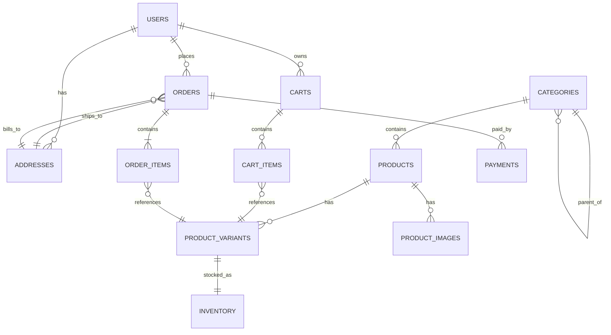
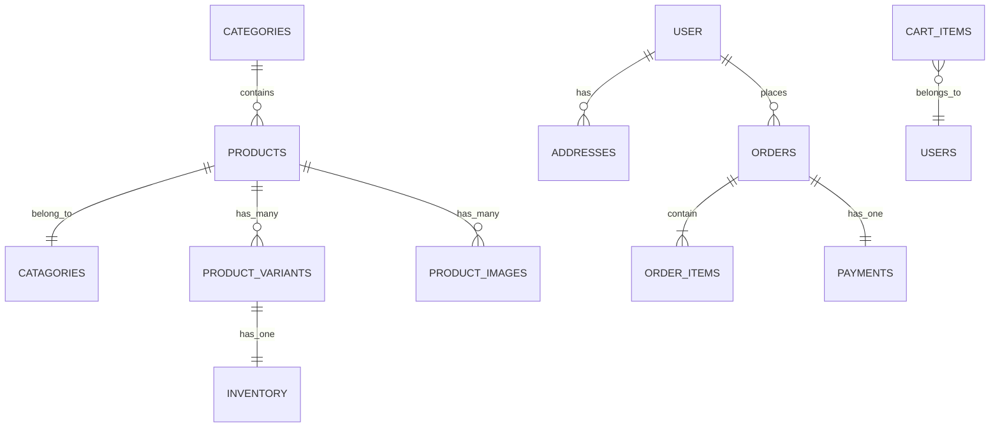

# Entity-Relationship Diagram

The data model for Manitou, derived from `PROJECT_PLAN.md` Section 6.3. Every line below
corresponds to a real foreign key in the schema.

Section 6.2 is a prose _summary_ of the main relationships; this diagram is the complete picture.
Where the two differ, Section 6.3 and this file are authoritative.

## Reading the notation

Each connector is two independent halves, one per side. The braces always point outward toward
the "many" end.

| Glyph  | Meaning      |
| ------ | ------------ |
| `\|\|` | exactly one  |
| `o\|`  | zero or one  |
| `o{`   | zero or more |
| `\|{`  | one or more  |

**On direction:** relationships are oriented so the label reads naturally left to right. Ownership
reads parent → child (`CARTS ||--o{ CART_ITEMS : contains`); lookups read child → parent
(`CART_ITEMS }o--|| PRODUCT_VARIANTS : references`). `}o--||` is simply the mirror of `||--o{` —
the cardinality is identical, only the reading order changes.

## Relationship notes

| Relationship                       | Cardinality            | Foreign key                       | Why this cardinality                                                                                                                                                                                                                                         |
| ---------------------------------- | ---------------------- | --------------------------------- | ------------------------------------------------------------------------------------------------------------------------------------------------------------------------------------------------------------------------------------------------------------ |
| `users` → `addresses`              | one to zero-or-more    | `addresses.user_id`               | A customer can save several addresses (home, work, gift recipient) — or none, if they've only just registered.                                                                                                                                               |
| `users` → `orders`                 | one to zero-or-more    | `orders.user_id`                  | Zero, because a newly registered user hasn't ordered yet.                                                                                                                                                                                                    |
| `users` → `carts`                  | one to zero-or-more    | `carts.user_id`                   | **Worth revisiting.** The schema puts no unique constraint on `carts.user_id`, so many carts per user are permitted. If the intent is one active cart per user, that needs an explicit constraint — a decision for Phase 1 task 5 (constraints and indexes). |
| `categories` → `categories`        | one to zero-or-more    | `categories.parent_id`            | **Self-referencing.** A category's parent is another category, letting "Apparel → T-Shirts → Long Sleeve" nest to any depth without a table per level. Nullable, because top-level categories have no parent.                                                |
| `categories` → `products`          | one to zero-or-more    | `products.category_id`            | One category holds many products; each product sits in exactly one. Drawn once — the connector already states both directions.                                                                                                                               |
| `products` → `product_variants`    | one to zero-or-more    | `product_variants.product_id`     | "T-Shirt" is the product; "Large / Red" is the variant. The variant carries the `sku`, because that's the unit actually sold.                                                                                                                                |
| `products` → `product_images`      | one to zero-or-more    | `product_images.product_id`       | Several photos per product, one flagged `is_primary`.                                                                                                                                                                                                        |
| `product_variants` → `inventory`   | **one to one**         | `inventory.variant_id` _(unique)_ | The only true one-to-one in the schema, and the `unique` constraint in Section 6.3 is what enforces it. Stock is tracked per variant, not per product — you can be out of Large Red while Small Blue is in stock.                                            |
| `carts` → `cart_items`             | one to zero-or-more    | `cart_items.cart_id`              | A cart exists before anything is in it, so zero is valid. The cart is a container with its own lifetime — that's why it earns a table rather than hanging items off `user_id` directly.                                                                      |
| `cart_items` → `product_variants`  | many to one            | `cart_items.variant_id`           | Points at the **variant**, not the product. You can't add "a T-shirt" to a cart — only a Large Red one. This is also what makes stock decrementing possible at checkout, since inventory hangs off the variant.                                              |
| `orders` → `order_items`           | **one to one-or-more** | `order_items.order_id`            | Not zero — an order with no line items shouldn't exist. Stronger than the schema alone requires; the API enforces it.                                                                                                                                        |
| `order_items` → `product_variants` | many to one            | `order_items.variant_id`          | Same reasoning as cart items. Note that `order_items` _also_ snapshots `product_name_snapshot` and `unit_price_snapshot`, so a past order still shows what the customer actually paid even if the variant is later renamed, repriced, or deleted.            |
| `orders` → `addresses` (ships_to)  | many to one            | `orders.shipping_address_id`      | One address serves many orders — a repeat customer ships to the same place.                                                                                                                                                                                  |
| `orders` → `addresses` (bills_to)  | many to one            | `orders.billing_address_id`       | A **second, separate** FK into the same table. Billing and shipping often differ, and each needs independent tracking.                                                                                                                                       |
| `orders` → `payments`              | one to zero-or-more    | `payments.order_id`               | Zero while the order is `pending`; many because a declined card followed by a retry is two records, and a refund is a third. Financial records are append-only — see Section 6.2.                                                                            |

## Design decisions worth remembering

**Why join tables point at variants.** Both `cart_items` and `order_items` reference
`product_variants` rather than `products`. The sellable unit is the SKU, not the abstract product.
Pointing at `products` would make inventory decrementing impossible, since stock lives on the
variant.

**Why `order_items` snapshots data.** It stores the product name and unit price at purchase time
rather than joining to the live product row. Prices change; order history must not. This is
deliberate denormalization, and it is standard practice — see Section 6.4.

**Why addresses aren't snapshotted the same way.** Orders reference `addresses` by FK, so editing
a saved address technically alters what past orders point at. `order_items` avoids this problem via
snapshots; orders do not. Worth deciding before Phase 2 whether shipping addresses should be
snapshotted onto the order too.

---

<!--
ORIGINAL SKETCH — superseded, kept for reference.

Drawn from Section 6.2's prose alone, before review. Eight of ten cardinalities were correct.
What the review changed:
  - CATAGORIES typo — Mermaid silently creates unknown names as new entities
  - USER vs USERS — same failure mode, rendered as two separate boxes
  - Line 6 duplicated line 5 in reverse, with contradictory cardinality
  - CARTS was missing entirely; CART_ITEMS was wired straight to USERS
  - Four relationships Section 6.2 never mentions: the CATEGORIES self-reference,
    both ORDERS -> ADDRESSES links, and the two -> PRODUCT_VARIANTS links
  - ORDERS -> PAYMENTS revised from one-to-one to zero-or-more

-->
